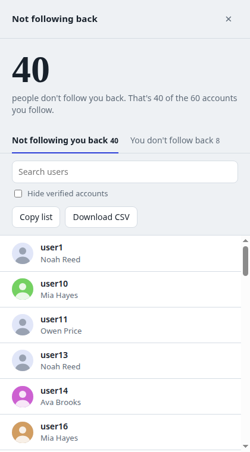
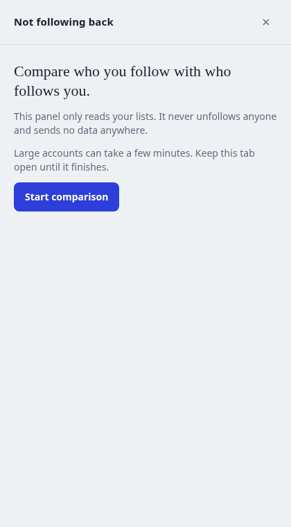
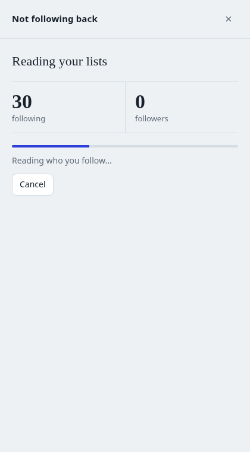
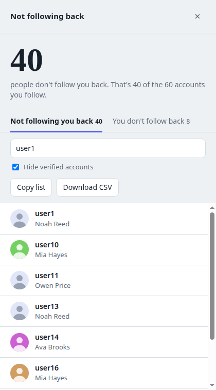
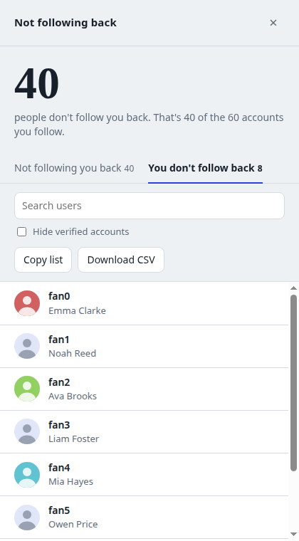
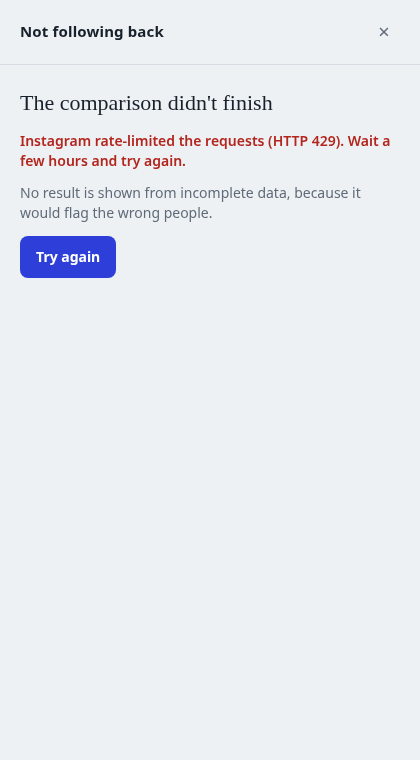
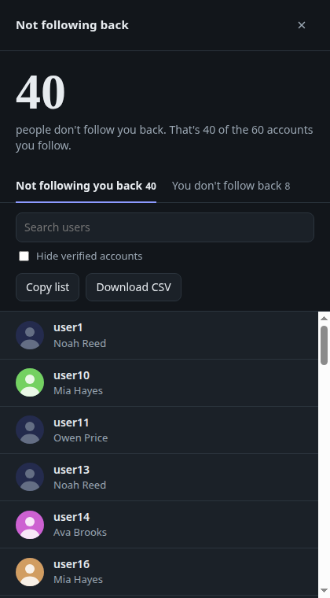

# instagram-unfollowers

A single-file tool you paste into your browser console to see which Instagram accounts you follow that don't follow you back. No install, no password, no third-party app.

*All screenshots use fake data.*

## Walkthrough

### 1. Paste the script

1. Log in to instagram.com on a computer.
2. Press `F12` to open developer tools and switch to the **Console** tab.
3. Copy the whole of [`not_following_back_ui.js`](not_following_back_ui.js), paste it into the console and press `Enter`. If the browser blocks pasting, type `allow pasting` and press `Enter` first.

A panel slides in from the right side of the page.

### 2. Start the comparison

The panel only reads your lists. It never unfollows anyone and sends no data anywhere.

Click **Start comparison**. If you see "No session found", you aren't logged in at instagram.com. Log in and run the script again.

 

### 3. Wait while the lists load

The panel reads who you follow, then who follows you, one page at a time. The counters update live. The progress bar shows the real percentage whenever Instagram reports your totals.

Large accounts take a few minutes. Keep the tab open, or press **Cancel** to stop.

 

### 4. Read the result

The big number is how many accounts you follow that don't follow you back. Two tabs split the lists:

- **Not following you back**: you follow them, they don't follow you.
- **You don't follow back**: they follow you, you don't follow them.

Click any row to open that profile in a new tab. Accounts without a profile photo, or whose photo can't be loaded, show a default silhouette instead.

 

### 5. Filter and export

Type in the search box to filter by username or name. Tick **Hide verified accounts** to drop celebrities and brands from the list.

**Copy list** puts the filtered usernames on your clipboard, one per line. **Download CSV** saves the same list as a spreadsheet. Both respect the active tab, search and filter.

 

Switch to **You don't follow back** to see your followers that you haven't followed in return. It uses the same search, filter and export buttons.

 

### 6. If something goes wrong

If Instagram rate-limits the requests (HTTP 429) or your session expires, the tool stops and tells you why. It shows no result in that case, because a half-loaded list would flag the wrong people.

Wait a few hours after a rate limit, then press **Try again**.

 

### Dark mode

The panel follows your system theme. `Esc` or the × button closes it. The result also stays available in the console as `window.__notFollowingBack`.

 

## How it works

The script runs inside your logged-in instagram.com tab and reads the `friendships/{id}/following` and `followers` endpoints that Instagram's own web app uses, one page at a time, waiting 1.5–3.5 seconds at random between pages. It then compares the two lists and shows the difference.

- **Read-only:** it never unfollows, likes or messages anyone.
- **Nothing leaves your browser:** requests go only to instagram.com.
- On an error it stops and shows no result, rather than reporting from incomplete data.

## Risks

- This uses Instagram's **unofficial** internal API. If Instagram changes its response format, the tool can break.
- Automated requests sit in a gray area of Instagram's terms of use. Running it often may get your account temporarily restricted, so use it rarely and once at a time.
- Read any code before you run it. Whatever you paste into the console runs with your session, so never paste scripts from sources you don't trust.
- Official alternative: use *Accounts Center → Download your information* to export your followers and following lists as JSON and compare them yourself.

## Disclaimer

Not affiliated with Instagram or Meta. Written for personal use on your own account.
