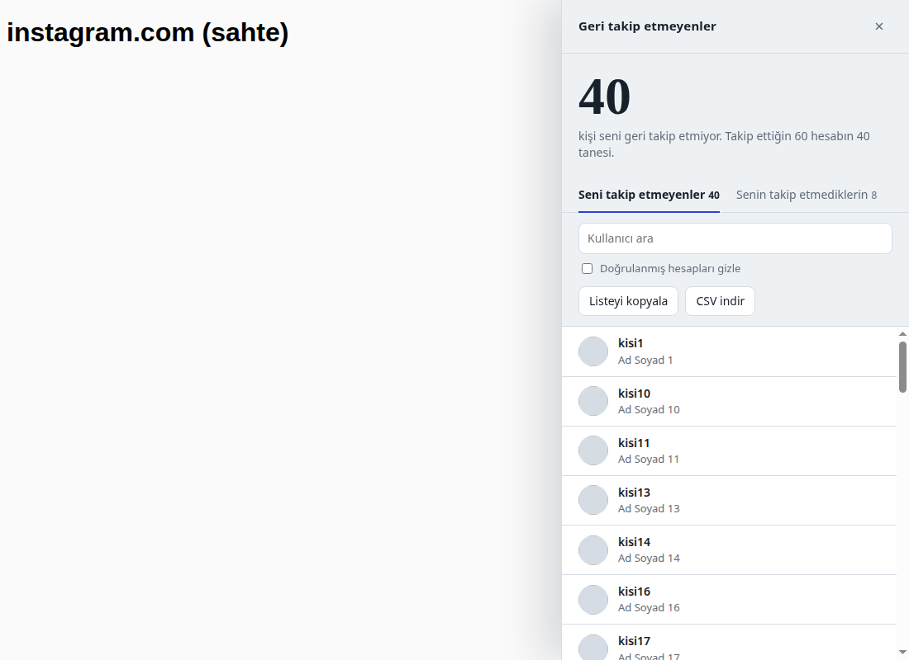

# instagram-unfollowers

Instagram'da takip ettiğin ama seni geri takip etmeyen hesapları gösteren, tarayıcı konsoluna yapıştırılan tek dosyalık bir araç. Kurulum, şifre veya üçüncü parti uygulama gerektirmez.

*Ekran görüntüsü sahte verilerle alındı.*

## Kullanım

1. instagram.com'a bilgisayardan giriş yap.
2. `F12` ile geliştirici araçlarını aç ve **Console** sekmesine geç.
3. [`not_following_back_ui.js`](not_following_back_ui.js) dosyasının tamamını kopyalayıp konsola yapıştır ve `Enter`'a bas. Tarayıcı yapıştırmayı engellerse önce `allow pasting` yazıp `Enter`'a bas.
4. Açılan panelde **Karşılaştırmayı başlat** düğmesine tıkla. Bin kişilik hesaplarda birkaç dakika sürer, bu sırada sekmeyi açık tut.

## Panelde neler var

- Canlı sayaç ve ilerleme çubuğu, istersen **Vazgeç** düğmesi.
- İki sekme: **Seni takip etmeyenler** ve **Senin takip etmediklerin**.
- Kullanıcı arama ve doğrulanmış hesapları gizleme.
- Filtrelenmiş listeyi **kopyalama** veya **CSV olarak indirme**.
- Bir satıra tıklayınca profil yeni sekmede açılır.
- `Esc` veya × paneli kapatır. Sonuç ayrıca `window.__notFollowingBack` içinde durur.

## Nasıl çalışır

Araç, oturumun açık olduğu sekmede Instagram'ın web arayüzünün kullandığı `friendships/{id}/following` ve `followers` uç noktalarını sayfa sayfa okur. Sayfalar arasında 1,5–3,5 saniye rastgele bekler. İki listeyi karşılaştırıp farkı gösterir.

- **Salt okunur:** hiçbir hesabı takipten çıkarmaz, beğenmez, mesaj atmaz.
- **Veri dışarı gitmez:** istekler yalnızca instagram.com'a yapılır. Başka hiçbir yere bir şey gönderilmez.
- Hata (örneğin HTTP 429) olursa durur ve eksik veriyle sonuç göstermez.

## Riskler

- Bu, Instagram'ın **resmi olmayan** iç API'sini kullanır. Instagram yanıt biçimini değiştirirse araç bozulabilir.
- Otomatik istekler Instagram'ın kullanım şartlarının gri alanında kalır. Sık çalıştırırsan hesabın geçici olarak kısıtlanabilir. Tek seferlik ve seyrek kullan.
- Kodu çalıştırmadan önce oku. Konsola yapıştırdığın her kod oturumunla çalışır, bu yüzden tanımadığın kaynaklardan gelen script'leri yapıştırma.
- Resmi alternatif: Instagram'ın *Hesap Merkezi → Bilgilerini indir* özelliğiyle JSON formatında takipçi ve takip edilen listelerini indirip kendin karşılaştırabilirsin.

## Not

Instagram ile bağlantılı değildir. Kendi hesabın için kişisel kullanım amacıyla yazılmıştır.
